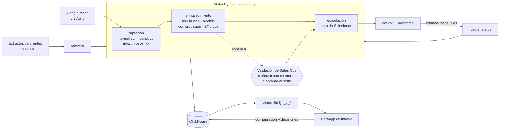

# Cómo funciona el Lead Generator

Explicación de todo el sistema: qué le pasa a una empresa desde que Google Maps la devuelve hasta que
llega a Salesforce, qué parte del código hace cada paso y qué reglas lo mantienen seguro. Los comandos
están en el [README](../README.md); dónde se aparta el código del Word, en
[Decisiones](outline/decisiones.md).

---

## 1. En un párrafo

El Lead Generator busca en Google Maps empresas de piscinas de Alemania, Austria y Suiza. Descarta las
que no son relevantes o ya son clientes de Fluidra, lee las webs de las demás con un modelo de IA y
puntúa cada lead sobre 37,5 puntos. Después Sales Ops revisa la lista, y los leads aprobados van a
Salesforce en un fichero `.xlsx`. Cada mes vuelve de Salesforce el estado de cada lead, para no volver a
proponer lo ya descartado o trabajado. Todo esto lo hace un motor en Python, que lo guarda en
ClickHouse. El DataApp de Intelek muestra los resultados a través de vistas dbt.



---

## 2. La vida de un lead

Cada paso es un comando aparte que lanza una persona. Nada se ejecuta de forma programada.

### Paso 1: Captación (`leadgen.py capture`)

Código: [steps/capture.py](../dwh/transf_py/leadgen/steps/capture.py).

1. **Búsqueda.** Para cada área y término de búsqueda (p. ej. el distrito `AT-501` × `Poolbau`), el
   actor de Google Maps de Apify devuelve fichas. El área se envía como su contorno oficial
   (`customGeolocation`, de los límites cargados con `load-geo`), no por su nombre: por nombre, Apify
   descarta todas las fichas ([Decisiones](outline/decisiones.md)). La respuesta se guarda tal cual en
   `fld_landinglgn`, para no tener que pagarla dos veces.
2. **Normalización** ([normalize.py](../dwh/transf_py/leadgen/normalize.py)):
   - teléfonos a E.164;
   - webs a su dominio registrable;
   - nombres a claves de comparación, escribiendo las diéresis como `ä→ae` y como `ä→a`, y quitando
     formas jurídicas como GmbH o KG;
   - códigos postales, números de IVA y registros mercantiles.
3. **Ubicación** ([geo.py](../dwh/transf_py/leadgen/geo.py)): la subregión sale de las coordenadas,
   comparadas con los límites oficiales, nunca del código postal.
4. **Identidad** ([identity.py](../dwh/transf_py/leadgen/identity.py)): cada ficha se convierte en un
   `business_id` estable. La misma empresa encontrada dos veces, por ejemplo con el mismo teléfono, se
   une en una sola con alias. Por eso un lead puede volver a aparecer el mes siguiente sin duplicarse.
5. **Filtro** (en SQL: [lgn_f_rule_evaluation.sql](../dwh/transf_dbt/models/leads/bizlgn/lgn_f_rule_evaluation.sql)):
   reglas deterministas sobre lo que dice Google, en un orden fijo, con la configuración vigente. El motor
   normaliza los textos (título, descripción, categorías) y lee la decisión de la vista. Decide la primera
   regla que se cumple:

   | # | Regla | Resultado |
   |---|---|---|
   | 1 | Cerrada definitivamente | fuera |
   | 2 | Suprimida, o excluida de forma permanente antes | fuera |
   | 3 | Regla de título HARD (p. ej. "Hotel") | fuera |
   | 4 | Una categoría INCLUDE | **dentro** |
   | 5 | Una categoría CONDITIONAL + una palabra de piscina en el título o la descripción | **dentro** |
   | 6 | Regla de título SOFT | fuera |
   | 7 | Una categoría EXCLUDE | fuera |
   | 8 | No se cumple ninguna | fuera |

   Este paso es gratis: se ejecuta antes de gastar nada.
6. **Primer cruce con clientes** ([matching.py](../dwh/transf_py/leadgen/matching.py)): ¿es ya
   cliente de Fluidra? Ver el [apartado 3](#3-ya-es-cliente).

El resultado es un **lote de captación** (`cb_…`) con una estimación del coste del paso siguiente,
calculada con la misma fórmula que usa el enriquecimiento (`cost.enrich_estimate`).

Antes de capturar se comprueba la antigüedad del extracto de clientes: bloqueo por encima de 7 días
(definición v3.3, DT.5). Para seguir sin cargar uno nuevo hay que lanzar la captación con
`--approve-stale-extract`, que queda registrado como aprobación de quien la lanza.

También se estima el coste de Apify antes de llamar (consultas × tope × precio por ficha). Si supera
`cost_approval_threshold_usd`, la captación no empieza hasta lanzarla con `--approve-cost USD`.

### Paso 2: Enriquecimiento (`leadgen.py enrich --capture-batch cb_…`)

Código: [steps/enrich.py](../dwh/transf_py/leadgen/steps/enrich.py). Es el paso que cuesta dinero.

1. **Control de coste.** Si la estimación supera `cost_approval_threshold_usd` (10 USD en los seeds),
   la ejecución se detiene en `AWAITING_COST_APPROVAL`. Solo sigue tras `approve-cost` y `resume`.
2. **Lectura de la web** ([crawl.py](../dwh/transf_py/leadgen/crawl.py)) con límites de páginas,
   bytes y tiempo, y respetando robots.txt. Playwright es opcional para webs que necesitan JavaScript.
   Una empresa sin web, con solo un perfil en redes sociales o con una web que bloquea la lectura pasa
   a REVIEW con ese motivo, sin consultar al modelo (si no tiene clientes candidatos). Aun así se
   puntúa, para que aparezca en la cola de validación.
3. **Preparación del contenido** ([content.py](../dwh/transf_py/leadgen/content.py)): pasa el HTML a
   texto, quita los bloques repetidos, se queda con las páginas con más señal dentro de un presupuesto
   de caracteres y reserva sitio para los fragmentos que mencionan marcas.
4. **Consulta al modelo** ([prompt.py](../dwh/transf_py/leadgen/prompt.py),
   [llm.py](../dwh/transf_py/leadgen/llm.py)):
   - **El prompt.** El prompt de sistema es el texto de la definición (igual en la v3.2 y la v3.3) del especialista de piscinas DACH, sin
     cambios. El modelo debe responder con un esquema JSON estricto que incluye:
     - validación: VALID / NOT_VALID / REVIEW;
     - tipo de empresa;
     - enriquecimiento: contacto, email, IVA…;
     - marcas de la competencia;
     - un veredicto SAME / DIFFERENT / UNSURE para cada cliente candidato.
   - **Proveedor.** OpenAI (`gpt-6.2-sol`) o Anthropic, según `llm_provider`; mismo prompt y mismo esquema.
   - **Modo.** Las peticiones van por la API de lotes del proveedor, más barata y más lenta, o directas para
     lotes pequeños (`--mode AUTO|BATCH|DIRECT`).
   - **Registro y reutilización.** Cada petición se guarda en la base de datos *antes* de enviarse. Si
     no cambian la empresa, la versión del prompt, la lista de marcas, los candidatos ni el contenido,
     se reutiliza la respuesta guardada y no se paga dos veces. Solo se reutiliza si la última respuesta
     guardada para ese lead es válida; si falló, se vuelve a preguntar.
   - **Coste real.** Al terminar, `cost_ledger` guarda lo que costaron las llamadas pagadas de la
     ejecución (reintentos incluidos, con el descuento de lote). Las respuestas reutilizadas no cuentan.
5. **Comprobación de la respuesta sin el modelo**
   ([response.py](../dwh/transf_py/leadgen/response.py)):
   - cada dato (un email, un número de IVA, una marca…) tiene que aparecer en la página que cita el
     modelo; si no aparece, se descarta;
   - una respuesta inválida o cortada se reintenta una vez; si vuelve a fallar, el lead pasa a REVIEW
     con motivo `TECHNICAL`;
   - el número de IVA se comprueba en VIES (UE) o en el registro UID (Suiza)
     ([vat.py](../dwh/transf_py/leadgen/vat.py)): `vat_check_status` VALID, NOT_FOUND, INVALID_FORMAT o
     UNAVAILABLE. Solo con VALID sale en `lgn_v_lead`; un servicio caído no detiene nada.
6. **Segundo cruce con clientes**, ya con los datos de la web y los veredictos del modelo.
7. **Puntuación**: no la calcula el motor. La calcula en SQL la vista dbt
   [`lgn_f2_score`](../dwh/transf_dbt/models/leads/bizlgn/lgn_f2_score.sql) a partir de lo que guarda este
   paso; ver el [apartado 4](#4-la-puntuación).

### Paso 3: Validación de Sales Ops

La validación funciona **por rechazo**. Sales Ops ve la cola en Intelek (`lgn_v_validation_queue`) o
con `leadgen.py review` y rechaza un lead con un motivo: `ALREADY_CUSTOMER`, `KA_CHAIN`, `DUPLICATE`,
`HOT_TUB_SAUNA_ONLY`, `NOT_VALID` o `BUSINESS_CLOSED`. Después, **approve-rest** acepta de forma
explícita todo lo que queda pendiente. Un rechazo por ser cliente o cadena se convierte además en una
corrección que respetan las ejecuciones posteriores. Un lead aprobado puede volver a revisión con
`reopen` mientras no se haya exportado, o si su exportación se confirmó como FAILED.

### Paso 4: Exportación (`leadgen.py export` y después `confirm-export`)

Código: [steps/export.py](../dwh/transf_py/leadgen/steps/export.py) y
[export.py](../dwh/transf_py/leadgen/export.py).

**Qué leads salen.** Solo se exportan los Aprobados. Un lead se salta si:
- ya se exportó antes;
- se ha convertido en cliente desde entonces (el rematch mensual puede descalificarlo);
- ha sido excluido.

**El fichero.** Es un `.xlsx` con las columnas de Salesforce de `biz_cfg_export_column` y el
propietario según la subregión. Sin propietario, la exportación se bloquea.

**Estado.** La exportación empieza como `GENERATED`. Una persona la sube y ejecuta
`confirm-export … --status UPLOADED`; solo entonces sus leads quedan **Publicados**. Si la subida
falla, `FAILED` permite volver a generar el fichero. La confirmación es definitiva: no se puede cambiar
después.

### Paso 5: Retroalimentación

- **`load-sf-status`** (mensual): el fichero de estados de Salesforce. Un lead descartado queda excluido
  para siempre en cuanto se carga (la exclusión se lee del fichero, no se copia) y, si era «ya cliente»,
  cuenta como corrección del cruce, que manda sobre las decisiones automáticas. Convertido, en curso o en seguimiento: el lead sigue Published.
- **`load-customers` y después `rematch`** (mensual): un extracto de clientes nuevo se vuelve a
  cruzar con todos los leads, de todos los perfiles.
- **`reprocess`**: tras cambiar las reglas (términos, categorías), vuelve a hacer el cruce con clientes
  de lo que ahora pasa el filtro. El filtro y los puntos no hace falta: se calculan en vivo en SQL. No llama a Apify, no lee webs ni consulta al modelo,
  así que no cuesta nada.

### El estado de un lead, tal como lo muestra Intelek

`lgn_v_lead.des_status` toma el primero que aplique:

**Publicado** › **Rechazado** › **Excluido por el motor** › **Aprobado** › **Por revisar** › **Encontrado**

---

## 3. ¿Ya es cliente?

[matching.py](../dwh/transf_py/leadgen/matching.py) compara cada lead con los extractos de clientes de
todas las filiales de Fluidra:

- **Las señales fuertes deciden solas:** el mismo número de IVA, registro mercantil, teléfono o
  dominio web (o dominio de email) que un cliente. Los dominios compartidos como gmail.com nunca
  cuentan.
- **Las señales débiles solo generan candidatos:** el mismo nombre normalizado, o un nombre parecido
  con al menos una palabra distintiva en común.
  - Un candidato se **confirma sin el modelo** cuando el nombre es lo bastante parecido *y* coinciden
    el código postal o la ciudad.
  - El resto va al modelo como candidatos `C1…Cn`, que responde SAME / DIFFERENT / UNSURE para cada
    uno.
- **Ante la duda, se aparta:** `UNSURE` cuenta como cliente. Llamar a un cliente como si fuera un lead
  nuevo es el error caro.
- **Cuando las fuentes no coinciden:** corrección humana o de Salesforce › señal fuerte › veredicto del
  modelo › confirmación débil.

---

## 4. La puntuación

Seis factores, máximo **37,5**. La puntuación no descarta a nadie, solo ordena la lista. Los puntos
vienen de `biz_cfg_scoring_rule`; el código solo decide en qué tramo cae cada lead.

Se calcula en SQL, en las vistas dbt `lgn_f2_score_component` (un tramo por factor) y `lgn_f2_score`
(total, rating y desglose), con la configuración **vigente**: un cambio de puntos o de umbrales se ve al
momento, sin reprocesar. Al exportar un lead, su puntuación se **congela** en `export_lead_out`; a
partir de ahí, `lgn_f_score` (lo que leen `lgn_v_lead` y las demás vistas) muestra la congelada, y la
viva solo para los que no se han exportado. Sin las vistas en la base de datos, `precheck`,
`enrich` y `export` se detienen con «ejecuta `python leadgen.py dbt`».

| Factor | Mejor tramo | Puntos |
|---|---|---|
| Tipo de empresa | constructor / instalador / tienda | 10 |
| Marcas de la competencia en su web | grupo 1 (profesional) | 7,5 |
| Zona estratégica de la subregión | ATTACK | 7,5 |
| Presencia digital | tienda online | 5 |
| Datos de contacto | persona + email + teléfono | 5 |
| Reseñas de Google | por encima del percentil 75 del país | 2,5 |

El rating sale de `biz_cfg_rating_band`: **HOT ≥ 30**, **WARM ≥ 20**, **COLD** por debajo.

---

## 5. Dónde viven los datos

Los datos están en ClickHouse, en seis bases de datos. En cada nombre, `fld` es Fluidra y `lgn` es el
lead generator.

| Capa | Base de datos | Qué contiene | Quién la escribe |
|---|---|---|---|
| landing | `fld_landinglgn` | Lo que llega de fuera, tal cual: Apify, páginas web, extractos, estados de Salesforce | motor |
| ops | `fld_opslgn` | Ejecuciones, instantáneas de configuración, peticiones al modelo, coste, exportaciones | motor |
| biz | `fld_bizlgn` | Configuración (`biz_cfg_*`), decisiones de validación, resultados del motor (`*_out`) | Intelek, motor |
| src → stg → crp → biz | `fld_srclgn` … | Solo vistas: tipado, configuración vigente, datos conformados y `lgn_v_*` para Intelek | dbt |

**Reglas que se cumplen en todas partes:**

- **Solo inserción.** Nunca se actualiza ni se borra nada.
  - La versión vigente de una fila es la última por `(inserted_at, updated_by)`.
  - "Borrar" una fila de configuración es volver a insertarla con `active = 0`.
  - El histórico completo siempre está ahí.
- **Un único contrato.** [ddl.py](../dwh/transf_py/leadgen/ddl.py) define todas las tablas que escribe
  el motor. El fichero de sources de dbt se *genera* a partir de él, y un test falla si se desalinean.
- **Dos estilos de nombres.** El código usa nombres lógicos (`country`, `notes`). Las tablas que
  Intelek lee o escribe usan los nombres físicos de estilo A (`pk_country`, `des_notes`).
  [store.py](../dwh/transf_py/leadgen/store.py) traduce entre ambos.
- **Instantánea de configuración.** Cada ejecución congela la configuración al arrancar. Una ejecución
  reanudada tres días después sigue usando las reglas con las que empezó.
- **Ámbito de la configuración.** Una fila puede ser para un país y perfil concretos o para todos
  (`NULL`). Gana la específica.

---

## 6. Configuración: quién decide los valores

El código no contiene valores de negocio. Cada umbral, término, categoría, marca, zona, puntuación y
columna de exportación es una fila de una tabla `biz_cfg_*`. Esas filas entran de tres formas:

1. **El Excel de inputs de TWP**, con `load-config`.
2. **Nuestros valores por defecto** en [seeds/](../dwh/transf_py/leadgen/seeds), con `seed`. Los
   valores propuestos por nosotros están marcados como `[PROPUESTA]`. El seed nunca sobrescribe un
   valor que alguien ya haya editado.
3. **Ediciones en Intelek**, que escriben filas nuevas.

`leadgen.py precheck` comprueba que la configuración está completa antes de una ejecución. Por
ejemplo, bloquea un perfil cuyas reglas TWP aún no ha enviado.

---

## 7. Estados de una ejecución

Cada ejecución escribe una fila en `ops.pipeline_run` cada vez que cambia de estado:

```
REQUESTED → SNAPSHOT_FROZEN → [AWAITING_COST_APPROVAL] → RUNNING → [AWAITING_BATCHES → COLLECTING] → CLOSED
                                                                                              ↘ FAILED
```

- **Reanudar.** `resume RUN_ID` retoma una ejecución donde se paró sin volver a pagar: las lecturas
  de webs y las respuestas del modelo están guardadas.
- **Sin solapes.** No pueden correr a la vez dos captaciones sobre áreas que se solapan: la misma
  área, una que contiene a la otra o una contenida en ella.

---

## 8. Cómo se prueba

`./run_tests.sh` ejecuta unos 200 tests sin base de datos, sin red y sin credenciales.

- **Ejecuciones de principio a fin.** Usan un almacén en memoria (`MemoryStore`), resultados de Apify
  falsos, webs falsas y un modelo falso, y recorren todos los tipos de ejecución: captación,
  enriquecimiento (con aprobación de coste, lotes y reanudación), validación, exportación, rematch y
  reprocess.
- **Tests unitarios.** Cubren la normalización, el orden del filtro, el cruce y la comprobación de
  respuestas.
- **Tests sobre ClickHouse** (`./run_db_tests.sh`, y en CI). Un ClickHouse desechable ejecuta el flujo
  completo y todos los modelos y tests de dbt con datos. Es donde se prueba la puntuación: contra una
  referencia guardada de lo que daba el motor en Python antes de pasarla a SQL, contra los ejemplos de
  la definición, y su congelación al exportar.
- **Tests de contrato.** El prompt conserva el texto de la definición, los seeds están completos y el DDL coincide
  con los sources de dbt.
- **Sintaxis SQL.** Cada modelo dbt se analiza como SQL de ClickHouse (sqlglot).

**Lo que los tests no demuestran:** el comportamiento de Apify, que solo se ha comprobado
con búsquedas sueltas de pago (un distrito de Austria y uno de Alemania,
[findings](../exploration/findings.md)). El Excel de inputs de TWP (v3 y v4) y sus listados de clientes
de AT, CH y DE sí se han cargado con los ficheros reales.

---

## 9. Mapa del código

```
leadgen.py                      el único punto de entrada: todos los comandos
dwh/transf_py/leadgen/
├── steps/                      un módulo por tipo de ejecución: capture, enrich, export, maintenance
├── normalize, geo, identity    limpiar los datos e ids de empresa estables
├── matching                    cruce con clientes (el filtro es SQL: lgn_f_rule_evaluation)
├── crawl, content              leer y preparar las webs
├── prompt, llm, response       consultar al modelo; comprobar su respuesta con las páginas
├── scoring, cost, export       puntos y rating; estimación de coste; filas de Salesforce
├── config, state, runs         configuración vigente e instantánea; estado actual; estados y bloqueos
├── store                       ClickHouse ↔ memoria; nombres lógicos ↔ físicos
├── ddl                         el contrato de todas las tablas
├── loaders, seed_loader        extractos de clientes, estados de Salesforce, límites, listas propias; seeds y Excel
├── geo_convert                 límites de DE y CH (GeoPackage) a GeoJSON en lon/lat
└── seeds/                      nuestros valores de configuración (CSV)
dwh/transf_dbt/models/leads/    vistas dbt: srclgn → stglgn → crplgn → bizlgn (lgn_v_* para Intelek)
dwh/governance/                 scripts de bases de datos, roles y permisos (los ejecutan los admins)
docs/outline/                   documentación en español, sincronizada con Outline
docs/spec/                      los Word del cliente
```
